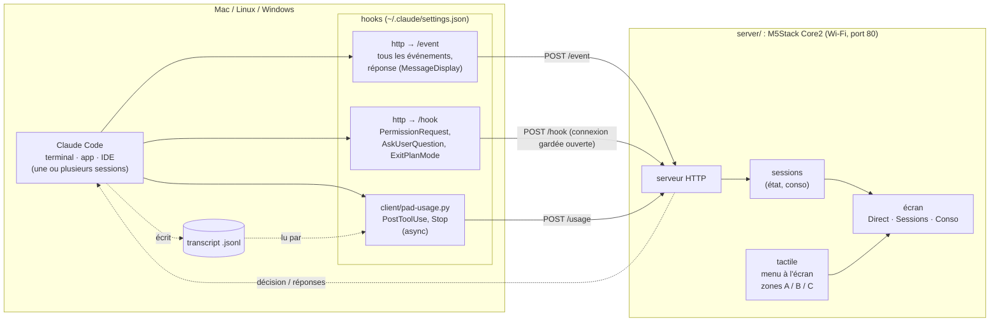
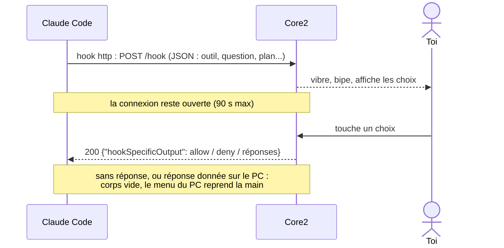

# Claude Pad — M5Stack Core2

Petit pad posé à côté du clavier :
- affiche ce que fait Claude Code (réflexion, outil en cours, terminé) et
  **sa réponse en direct**, au fil de l'écriture (sans les blocs de code ni
  le détail des commandes) ;
- **vibre et bipe** quand Claude attend ta réponse (rappel toutes les 30 s) ;
- **répond depuis l'écran tactile** aux demandes de Claude : permission
  (Oui / Oui, ne plus demander / Non), question à choix (simple ou multiple),
  validation de plan ;
- les zones tactiles **A / B / C** sous l'écran ouvrent trois vues :
  **Sessions** (toutes les sessions en cours, leur état et leur dernière
  activité ; toucher une ligne ouvre sa conso), **Conso** (contexte occupé,
  tokens, prix équivalent API) et **Direct** (l'état de Claude). Appuyer deux
  fois sur la même zone, ou attendre 30 s, ramène au direct.

Le dépôt a deux parties :
- **`server/`** : le firmware du pad (M5Stack Core2), à flasher une fois ;
- **`client/`** : les hooks Claude Code, à installer sur chaque PC dont tu
  veux suivre les sessions (macOS, Linux, Windows).

## Architecture

Rendu hors GitHub : ouvre [docs/architecture.html](docs/architecture.html) dans un navigateur.
Après avoir modifié un diagramme ci-dessous : `python3 docs/build-architecture.py`.



Une demande de Claude, de bout en bout :



Claude Code envoie lui-même les événements au pad (hooks `http`) : rien à
lancer sur le PC. Pour une demande, le pad garde la connexion ouverte et
répond directement avec la décision (`allow` / `deny`, règle « ne plus
demander », réponses aux questions). Pas de clavier simulé : ça marche dans
le terminal comme dans l'app de bureau, quelle que soit la fenêtre au premier
plan. Pad éteint, délai dépassé (90 s) ou réponse donnée sur le PC : le menu
habituel de Claude Code reprend la main.

## 1. Flasher le pad (`server/`)

```bash
cd server
pio run -t upload
pio device monitor        # facultatif : affiche l'IP et http://claude-pad.local
```

Le Core2 utilise un pont USB CH9102 (modèles récents) ou CP2104 (anciens).
Si le port n'apparaît pas, installe le pilote correspondant.

### Régler le Wi-Fi

Au premier démarrage, le pad ouvre le point d'accès **Claude-Pad** et affiche
un QR code :
1. sur ton téléphone, rejoins le Wi-Fi « Claude-Pad » (ou scanne le code) ;
2. la page de réglage s'ouvre seule (sinon : http://192.168.4.1) ;
3. choisis ton réseau (2,4 GHz), tape son mot de passe : le pad redémarre
   et affiche son adresse.

Le réseau est gardé en mémoire, même après un nouveau flash. Pour en
changer : **touche l'écran pendant « Connexion à … »** au démarrage. Si le
réseau enregistré ne répond pas (box en panne), le pad rouvre le point
d'accès et réessaie toutes les 5 minutes.

Facultatif : `server/include/secrets.h` (copie de `secrets.h.example`) donne
un réseau par défaut tant qu'aucun n'a été choisi sur le pad, et permet de
changer le nom mDNS.

## 2. Brancher Claude Code (`client/`)

Sur chaque machine, sur le même réseau que le pad. Il faut Python 3 pour
l'installeur et pour la vue Conso (déjà là sur macOS et Linux ; sous
Windows, python.org ou Microsoft Store) :

```bash
python3 client/install.py 192.168.1.169   # macOS / Linux (ou ./client/install.sh)
py client\install.py 192.168.1.169        # Windows
python3 client/install.py --uninstall      # pour les retirer
```

Sans adresse, le script prend `http://claude-pad.local`. Sous Windows, donne
plutôt l'IP : la résolution `.local` n'y est pas toujours fiable.

Le script ajoute les hooks du pad dans `~/.claude/settings.json` sans toucher
au reste (sauvegarde en `.bak`) ; le relancer remplace l'adresse, et il
remplace aussi les anciens hooks (scripts `pad-event.py` / `pad-prompt.py`,
`curl`). À la main : fusionne `client/settings.json` en adaptant l'adresse et
le chemin de `pad-usage.py`.

Les hooks :
- **http → `/event`** (tous les événements) : l'activité pour l'affichage.
  Délai de 2 s : pad éteint, Claude n'est jamais bloqué (un hook http en
  échec ne bloque rien).
- **http → `/event` sur `MessageDisplay`** : la réponse de Claude, envoyée
  par paquets de lignes pendant qu'elle s'affiche. Le pad en montre la fin,
  sans Markdown ; les blocs de code deviennent « [code] ». Claude Code attend
  ce hook avant d'afficher chaque paquet : délai de 1 s, pour qu'un pad éteint
  ne ralentisse pas trop l'affichage (retire ce hook si le pad est souvent
  éteint).
- **http → `/hook`** (`PermissionRequest`, et `PreToolUse` pour
  `AskUserQuestion|ExitPlanMode`) : le pad attend le choix fait à l'écran et
  renvoie la décision. `timeout` de 120 s ; le pad rend la main à 90 s.
- **`pad-usage.py`** (`PostToolUse`, `Stop`, en `async`) relit le transcript
  de la session et envoie au pad le contexte occupé, les tokens cumulés
  (sous-agents compris) et le prix au tarif de l'API Anthropic. C'est le seul
  script : le pad ne peut pas lire le transcript. Sans Python, seule la vue
  Conso reste vide.
- `SessionEnd` retire la session de la liste.

Sans installeur (pas de Python), colle dans `~/.claude/settings.json` les
hooks `http` de `client/settings.json` en remplaçant l'adresse.

Test sans Claude :
```bash
curl -X POST http://claude-pad.local/event -H 'Content-Type: application/json' \
  -d '{"hook_event_name":"Notification","message":"Claude veut lancer: rm -rf build","cwd":"/home/louis/mon-projet"}'
```

> **Linux** : la résolution `.local` passe par avahi (`nss-mdns`). Si elle ne
> marche pas, remplace `claude-pad.local` par l'IP affichée au démarrage
> (et fixe-la par bail DHCP sur ta box).

## Limites (et suites possibles)

- Pendant que le pad attend, une **question** ou un **plan** n'apparaît pas
  sur le PC (le hook passe avant) : réponds sur le pad, ou attends le délai.
  Pour les **permissions** dans l'app de bureau, le menu s'affiche en même
  temps et la première réponse l'emporte.
- Plus de bouton STOP : un hook ne peut pas interrompre Claude. Refuser une
  demande depuis le pad arrête l'action en cours.
- Une seule demande à la fois pour toutes les sessions : la dernière gagne
  (la précédente retombe sur le menu du PC).
- Les hooks `http` et `MessageDisplay` demandent une version récente de
  Claude Code.
- Le pad montre la réponse de la dernière session active : deux sessions qui
  répondent en même temps s'alternent à l'écran.
- Pendant une demande de permission, la commande reste affichée : c'est ce
  qu'on autorise.
- Le prix est un **équivalent API** (tarifs codés dans `pad-usage.py`) : avec
  un abonnement Pro / Max, ce n'est pas ce que tu paies. Le contexte suppose
  une fenêtre de 1 M tokens (200 k pour Haiku 4.5).
- Le pad oublie les sessions au redémarrage, et celles sans nouvelles depuis 12 h.
- Questions : 4 au maximum, 4 options chacune (la réponse libre « Other »
  n'est pas proposée sur le pad).
- Pas d'authentification sur `/event`, `/hook`, `/usage` : à garder sur un
  réseau local de confiance. Le point d'accès de réglage est ouvert (sans mot
  de passe) le temps du réglage.
- Le pad ne rejoint que les réseaux 2,4 GHz (limite de l'ESP32).
